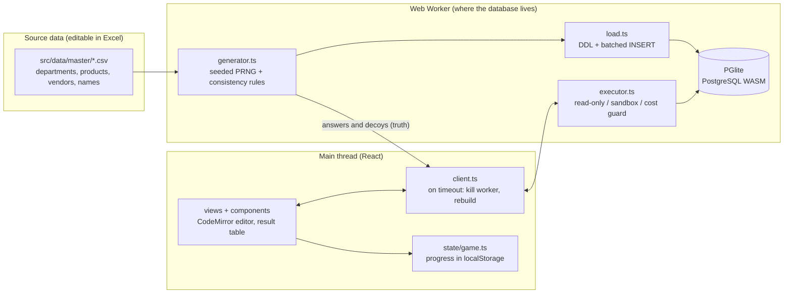
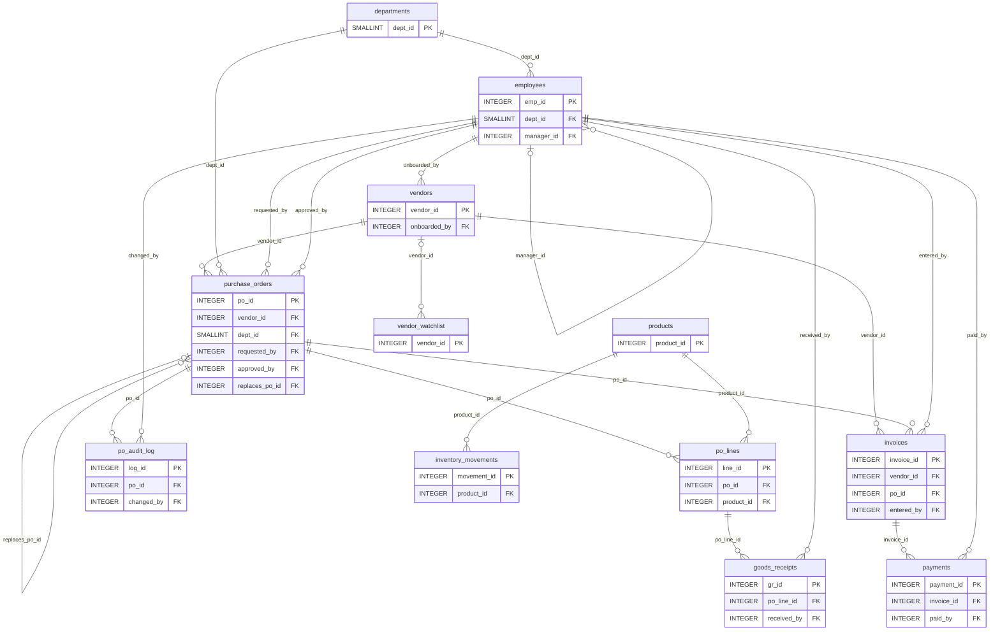

# Ledger Detective

A browser-based SQL detective game that runs **real PostgreSQL** in the page. You play an auditor and use SQL to uncover 18 cases hidden in about 22,000 rows of purchasing and payment data for a fictional company, Harbourline Supply Co.

- **No backend, no database server.** PostgreSQL runs as WebAssembly ([PGlite](https://pglite.dev)) inside the player's browser, so the whole project is a static site that deploys straight to Vercel.
- **Every round is different.** A round starts with a case code (for example `K7QX2M`) and the data is generated from it. The same code always gives the same data; a new code regenerates everything, including where the anomalies are and how many there are.
- **Built for practising PostgreSQL:** JOINs, aggregation, date and text functions, CTEs, window functions and set operations in the cases, plus INSERT / UPDATE / DELETE / UPSERT / VIEW / INDEX / EXPLAIN in the sandbox.

## Quick start

Requires Node.js 20.19 or newer (22 recommended, see `.nvmrc`).

```bash
npm install
npm run dev        # development server
npm test           # data integrity and case-answer verification
npm run build      # type check + production build into dist/
npm run preview    # preview the production build
```

## Architecture



**Data flow**

1. **Start of a round.** The UI starts the worker and passes it the case code. The worker reads the master CSVs, generates the whole dataset with a seeded random generator (and records the correct answer and the decoys for every case), then creates the tables, loads them, builds the indexes and runs `ANALYZE`.
2. **The player writes SQL.** The main thread sends the SQL to the worker. `executor.ts` runs it in the right mode and returns columns, rows and the error position; the UI renders the result.
3. **Submitting an answer.** The UI takes the result of the last SELECT and `check.ts` compares the named column, as a set, with the answer recorded at generation time. A wrong answer gets specific feedback depending on which kind of decoy was caught.
4. **Progress** (hints, scores, the features practised) is kept in the browser's localStorage.

**One source of truth.** `src/data/schema.ts` drives the DDL, the in-game table browser (column notes come from `COMMENT ON`), the Excel data dictionary and the diagram in this document, so they cannot disagree.

## How the data is designed

Size (varies slightly per round): about 115 employees, 70 vendors, 84 products, about 1,700 purchase orders, 4,300 PO lines, 4,600 goods receipts, 1,700 invoices, 1,600 payments and 7,000 stock movements, roughly 22,000 rows in all.

**Consistency (the data never contradicts itself).** The generator guarantees the rules below, and the tests verify them for 120 random seeds (20 integrity probes per seed):

- A PO total equals the sum of its lines; approval is later than creation; only the CEO has no manager.
- An invoice's vendor matches the PO's vendor; due date = invoice date + the vendor's payment terms; instalments add up to the invoice amount.
- Goods are not received before approval or beyond the quantity ordered; an invoice is not dated before the last receipt; a closed PO always has an invoice; a cancelled PO has no receipts or invoices.
- Product category matches vendor category; the requester's department equals the PO's department; former employees never appear in any role.
- The stock ledger's RECEIPT rows mirror `goods_receipts` one to one.

**Different every time.** A seeded PRNG (xmur3 + mulberry32, forked per generation stage so that changing one stage does not disturb the others). Who the mastermind is, which vendors are ghosts, and how many anomalies each case has and where all change with the seed.

**Unique answers, fair traps.** Every case plants real anomalies and look-alikes that are not violations (for example amounts lowered after approval, voided duplicates, instalment payments, amounts just under the approval threshold). The tests guarantee that each case's reference SQL returns exactly the answer recorded at generation time, and that decoys never overlap the answer.

**Money** is computed internally in integer cents to avoid floating-point error, and is `NUMERIC(12,2)` in the database.

## The cases

<!-- CASES:START -->
| # | Case | Level | Scenario | SQL practised |
| --- | --- | --- | --- | --- |
| 1 | Edited After Approval | Beginner | Approved, then quietly raised | JOIN, WHERE, ::numeric type cast, Comparing timestamps |
| 2 | Invoiced, Never Paid | Beginner | Booked invoices that nobody ever paid | LEFT JOIN … IS NULL, NOT EXISTS, Date arithmetic |
| 3 | Double Payment | Intermediate | One invoice entered twice and paid twice | GROUP BY on several columns, HAVING, COUNT(DISTINCT), string_agg |
| 4 | Skipping the Chain of Command | Intermediate | Approving your own purchase? | Self join, IS DISTINCT FROM, Table aliases |
| 5 | Order Splitting | Intermediate | One big order, cut into several small ones | date_trunc, GROUP BY, HAVING with several aggregate conditions, MAX / SUM |
| 6 | Ghost Vendor | Advanced | This vendor seems to exist only on paper | regexp_replace, JOIN ON an expression, Regular expressions |
| 7 | Stock Drift | Advanced | The book balance stops matching the ledger from one entry on | Window functions: SUM() OVER, ROW_NUMBER() OVER, CTE (WITH) |
| 8 | Three-Way Match | Advanced | Goods half delivered, invoice billed in full | CTE to aggregate first, LEFT JOIN, COALESCE, Avoiding fan-out |
| 9 | Finale: Connecting the Chain | Finale | One name, on all three lists | CTE, INTERSECT, DISTINCT, Reusing earlier queries |
| 10 | Urgent, Always Urgent | Follow-up | A vendor whose invoices all arrive with a pressure note | ILIKE, FILTER (WHERE …), Conditional counts in HAVING |
| 11 | Missing Cheques | Follow-up | A cheque number that nobody recorded | generate_series, EXCEPT, substr and casting |
| 12 | Price Creep | Follow-up | The price jumps again with the next order | LAG(), PARTITION BY several columns, Filtering on a window result |
| 13 | Re-issue Loop | Follow-up | Cancel it, raise it again, cancel it, raise it again | WITH RECURSIVE, Walking a chain of parent and child rows, GROUP BY on the result |
| 14 | Thin File | Follow-up | A vendor form with most of the boxes unticked | JSONB operators -> and ->>, jsonb_each_text, split_part |
| 15 | Undo the Double Payment | Hands-on | Void the duplicates and take their payments back off the books | UPDATE, DELETE … USING, RETURNING, Checking rows before changing them |
| 16 | The Watchlist | Hands-on | Add the inactive vendors, some of them are already listed | INSERT … SELECT, ON CONFLICT DO UPDATE (upsert), EXCLUDED, RETURNING |
| 17 | Latest per Vendor | Hands-on | Keep each vendor's newest invoice in a table of its own | DISTINCT ON, CREATE TABLE … AS SELECT, ALTER TABLE … ADD PRIMARY KEY |
| 18 | Slow Report | Hands-on | The payments-by-date report reads the whole table | EXPLAIN, CREATE INDEX, Reading a query plan |
<!-- CASES:END -->

Each case has three hint levels (10 points each), a concept card, common pitfalls and a worked solution. Scoring: 100 points, minus the hint and wrong-submission penalties, never below 20; opening all three hints and then giving up reveals the solution and scores 0. The finale (case 9) unlocks after you close six others. Cases 10 to 18 are follow-up files: 10 to 14 teach one query technique each (ILIKE and FILTER, generate_series and EXCEPT, LAG, JSONB, WITH RECURSIVE), and 15 to 18 are hands-on cases that change data (UPDATE / DELETE / RETURNING, INSERT … ON CONFLICT, CREATE TABLE AS with DISTINCT ON and ALTER TABLE, EXPLAIN and CREATE INDEX). The first hint of every case teaches the command itself.

## Engine and safety

| Mode | Behaviour |
| --- | --- |
| Case | A read-only transaction that is always rolled back. INSERT / UPDATE / DELETE / DDL are blocked before sending, and the database itself is `READ ONLY`, so even a write hidden inside a `WITH` is rejected by PostgreSQL. |
| Fix (hands-on cases) | The script may change anything inside a normal transaction. The case's own check query then reads the resulting state, and the whole transaction is rolled back, so every run starts from pristine data. The answer is judged on the state, not on a result set. |
| Sandbox | Entering opens one long transaction and each run is a savepoint (a multi-statement run either fully succeeds or is fully undone). Leaving or pressing Reset does a `ROLLBACK`. `BEGIN` / `COMMIT` are blocked so a player cannot escape the sandbox. |
| Cost guard | A SELECT is first planned with `EXPLAIN (FORMAT JSON)`; if the estimated rows or cost is too high (for example a Cartesian product from a missing JOIN condition) it is refused. |
| Timeout | After 12 seconds the worker is terminated and the database is rebuilt from the same seed within a few seconds. |
| Result cap | At most 1,000 rows per result. Numerics and dates are kept as text so JavaScript never loses precision. |

## Editing the master data in Excel

The CSV files in `src/data/master/` are the game's master data. Open them in Excel, edit them, and save as "CSV UTF-8 (comma delimited)".

| File | Contents |
| --- | --- |
| `departments.csv` | Departments, cost centres, headcount, which categories they buy, PO weight, job titles |
| `products.csv` | Product name, category, unit, list price (7 categories x 12 products) |
| `vendors.csv` | Vendor name, country, category, payment terms, `ghost_pool` (1 = may be picked as a ghost vendor) |
| `first_names.csv` / `last_names.csv` | Name pools for employees |

The files are validated on load, with readable errors that say which rule failed (for example an unknown category or a non-numeric payment term). After editing, run `npm test` to confirm the new master data still produces consistent data with unique answers.

To export a round to Excel (handy for filtering and pivoting alongside the SQL):

```bash
npm run export:xlsx                          # default case code DEMO42, written to exports/
npm run export:xlsx -- K7QX2M                # a specific case code
npm run export:xlsx -- K7QX2M --with-answers # also add an Answers sheet (spoilers)
```

This produces `ledger-detective-<code>.xlsx` (README, data dictionary, ER diagram, and the 12 tables, with real Excel dates and numbers) and `master-data.xlsx` (the 5 master files).

## Tests

```bash
npm test            # 8 seeds in full + engine tests + sandbox example tests
npm run test:wide   # 120 seeds (slower; CI runs it on push)
npm run docs:check  # are the generated README blocks in sync with the code?
```

- `tests/dataset.test.ts`: 20 integrity probes per seed; the 9 reference solutions must equal the planted answers; decoys must not overlap answers.
- `tests/executor.test.ts`: read-only protection, sandbox atomicity and reset, the cost guard, error positions.
- `tests/content.test.ts`: every sandbox example, case starter and concept example must run on real data; feature detection.

## Deploying

### GitHub

```bash
git init
git add .
git commit -m "Initial commit"
git branch -M main
git remote add origin https://github.com/<your-account>/ledger-detective.git
git push -u origin main
```

### Vercel

1. In Vercel choose **Add New, then Project**, and import the GitHub repository.
2. The framework is detected as Vite; `vercel.json` already sets `npm ci`, `npm run build` and the `dist` output. No environment variables are needed.
3. Deploy. Every later push to `main` redeploys automatically.

The first visit downloads about 4 to 5 MB (compressed) of PostgreSQL WASM; after that the browser caches it (`/assets` has a long cache lifetime).

## Project structure

```
src/
  data/        master CSVs, seeded PRNG, schema (single source of truth), generator, loader
  cases/       the 18 cases: story, hints, lessons, reference solution, decoy feedback
  engine/      worker, executor (read-only / sandbox / cost guard), client, answer checking
  state/       game progress (localStorage), React context
  lib/         PostgreSQL feature detection, sandbox examples, router, CSV export
  components/  editor (CodeMirror), result table, schema browser, ER diagram, closing screen
  views/       home, case list, case workspace, sandbox, report
scripts/       export-xlsx, gen-docs
tests/         data integrity, executor, example SQL, docs sync
```

## Known limitations

- **The answers live in the front end.** This is a static site, so the answers and reference solutions are bundled into the browser code. Anyone who opens the developer tools can see them. It suits practice and a portfolio piece, not a competition with a leaderboard.
- **Read-only protection is not a security boundary.** Case mode keeps a player from breaking the game, but the database runs in the player's own browser, so they can do anything to their own copy.
- **The cost guard is an estimate.** The planner can be wrong; the 12-second timeout is the backstop.
- **The first load is large.** PostgreSQL WASM is about 14 MB (about 4 to 5 MB compressed), which takes a moment on mobile data.
- **No server-side leaderboard or accounts.** Progress lives in each browser's localStorage and disappears if you switch browsers or clear the data.
- **Mobile is only lightly adapted.** It is readable and usable, but writing SQL is better on a computer.

## Data dictionary

<!-- DICT:START -->
### departments

Department master

| Column | Type | Description |
| --- | --- | --- |
| dept_id | SMALLINT (PK) | Department ID |
| dept_name | TEXT (unique, NOT NULL) | Department name |
| cost_center | TEXT (unique, NOT NULL) | Cost centre code |

### employees

Employee master (manager_id points to the direct manager in this same table; the CEO has none)

| Column | Type | Description |
| --- | --- | --- |
| emp_id | INTEGER (PK) | Employee ID |
| full_name | TEXT (NOT NULL) | Full name |
| email | TEXT (unique, NOT NULL) | Company email |
| dept_id | SMALLINT (FK to departments(dept_id), NOT NULL) | Department |
| title | TEXT (NOT NULL) | Job title |
| manager_id | INTEGER (FK to employees(emp_id)) | emp_id of the direct manager (NULL for the CEO) |
| hire_date | DATE (NOT NULL) | Hire date |
| status | TEXT (NOT NULL) | Employment status: active / terminated |
| bank_account | TEXT (NOT NULL) | Payroll bank account (BSB + account number, 14 digits) |

### vendors

Vendor master

| Column | Type | Description |
| --- | --- | --- |
| vendor_id | INTEGER (PK) | Vendor ID |
| vendor_name | TEXT (unique, NOT NULL) | Vendor name |
| country | CHAR(2) (NOT NULL) | Country code (ISO 3166-1 alpha-2) |
| category | TEXT (NOT NULL) | Main supply category |
| payment_terms_days | SMALLINT (NOT NULL) | Payment terms in days (counted from the invoice date) |
| bank_account | TEXT (NOT NULL) | Vendor bank account (formats vary: may contain hyphens or spaces) |
| tax_id | TEXT (NOT NULL) | Tax ID (ABN format) |
| status | TEXT (NOT NULL) | Relationship status |
| onboarded_by | INTEGER (FK to employees(emp_id), NOT NULL) | Set up by (employee) |
| onboarded_on | DATE (NOT NULL) | Set-up date |
| profile | JSONB (NOT NULL) | Onboarding form as JSON: contact {name, email, phone}, address {line1, city, state}, checks {abn_verified, bank_verified, site_visit}, directors [names] |

### products

Product master

| Column | Type | Description |
| --- | --- | --- |
| product_id | INTEGER (PK) | Product ID |
| sku | TEXT (unique, NOT NULL) | SKU |
| product_name | TEXT (NOT NULL) | Product name |
| category | TEXT (NOT NULL) | Category (matches vendors.category) |
| unit | TEXT (NOT NULL) | Unit of measure |
| list_price | NUMERIC(12,2) (NOT NULL) | List price (AUD) |

### purchase_orders

Purchase order header (all amounts in AUD)

| Column | Type | Description |
| --- | --- | --- |
| po_id | INTEGER (PK) | Internal PO ID |
| po_number | TEXT (unique, NOT NULL) | PO number (as shown to people) |
| vendor_id | INTEGER (FK to vendors(vendor_id), NOT NULL) | Vendor |
| dept_id | SMALLINT (FK to departments(dept_id), NOT NULL) | Requesting department |
| requested_by | INTEGER (FK to employees(emp_id), NOT NULL) | Requested by |
| approved_by | INTEGER (FK to employees(emp_id), NOT NULL) | Approved by |
| created_at | TIMESTAMP (NOT NULL) | Created at |
| po_date | DATE (generated) | PO date (a generated column derived from created_at) |
| approved_at | TIMESTAMP (NOT NULL) | Approved at |
| total_amount | NUMERIC(12,2) (NOT NULL) | PO total = sum of line_amount in po_lines |
| status | TEXT (NOT NULL) | open = not yet received / received = received, not invoiced / closed = invoiced / cancelled |
| replaces_po_id | INTEGER (FK to purchase_orders(po_id)) | If this PO was raised to replace an earlier (cancelled) one, that PO's po_id; NULL for an original PO |

### po_lines

Purchase order lines

| Column | Type | Description |
| --- | --- | --- |
| line_id | INTEGER (PK) | Line ID |
| po_id | INTEGER (FK to purchase_orders(po_id), NOT NULL) | Parent purchase order |
| line_no | SMALLINT (NOT NULL) | Line number within the PO |
| product_id | INTEGER (FK to products(product_id), NOT NULL) | Product |
| qty | INTEGER (NOT NULL) | Quantity ordered |
| unit_price | NUMERIC(12,2) (NOT NULL) | Agreed unit price |
| line_amount | NUMERIC(12,2) (generated) | Line amount (generated column: qty × unit_price) |

### goods_receipts

Goods receipts: a line can arrive in batches, so one po_line_id can have several rows

| Column | Type | Description |
| --- | --- | --- |
| gr_id | INTEGER (PK) | Receipt ID |
| po_line_id | INTEGER (FK to po_lines(line_id), NOT NULL) | Matching PO line |
| received_qty | INTEGER (NOT NULL) | Quantity received this time |
| received_date | DATE (NOT NULL) | Receipt date |
| received_by | INTEGER (FK to employees(emp_id), NOT NULL) | Received by |

### invoices

Vendor invoices. Note: the system has no unique constraint on (vendor_id, invoice_number)

| Column | Type | Description |
| --- | --- | --- |
| invoice_id | INTEGER (PK) | Internal invoice ID (order of entry) |
| invoice_number | TEXT (NOT NULL) | Invoice number printed by the vendor |
| vendor_id | INTEGER (FK to vendors(vendor_id), NOT NULL) | Vendor |
| po_id | INTEGER (FK to purchase_orders(po_id), NOT NULL) | Matching purchase order |
| invoice_date | DATE (NOT NULL) | Invoice date |
| due_date | DATE (NOT NULL) | Due date (invoice date + payment terms) |
| amount | NUMERIC(12,2) (NOT NULL) | Invoice amount |
| status | TEXT (NOT NULL) | posted = booked / disputed = under dispute / void = cancelled |
| entered_by | INTEGER (FK to employees(emp_id), NOT NULL) | Entered by (accounts payable) |
| notes | TEXT | Free-text note typed by the clerk when booking the invoice (usually empty) |

### payments

Payments: an invoice can be paid in instalments, so one invoice_id can have several rows

| Column | Type | Description |
| --- | --- | --- |
| payment_id | INTEGER (PK) | Payment ID |
| invoice_id | INTEGER (FK to invoices(invoice_id), NOT NULL) | Matching invoice |
| payment_date | DATE (NOT NULL) | Payment date |
| amount | NUMERIC(12,2) (NOT NULL) | Amount paid this time |
| method | TEXT (NOT NULL) | Payment method |
| paid_by | INTEGER (FK to employees(emp_id), NOT NULL) | Paid by (employee) |
| bank_ref | TEXT (NOT NULL) | Bank reference (EFT… / BPY… / CHQ + cheque number, cheques are numbered in sequence) |

### po_audit_log

Change log for purchase order fields (old and new values are stored as text)

| Column | Type | Description |
| --- | --- | --- |
| log_id | INTEGER (PK) | Log entry ID |
| po_id | INTEGER (FK to purchase_orders(po_id), NOT NULL) | Changed purchase order |
| changed_by | INTEGER (FK to employees(emp_id), NOT NULL) | Changed by |
| changed_at | TIMESTAMP (NOT NULL) | Changed at |
| field_name | TEXT (NOT NULL) | Field that was changed: total_amount / delivery_date / ship_to |
| old_value | TEXT | Old value (text) |
| new_value | TEXT | New value (text) |

### inventory_movements

Stock movement ledger. qty is a signed movement; balance_after is the balance the system recorded after it

| Column | Type | Description |
| --- | --- | --- |
| movement_id | INTEGER (PK) | Movement ID (increases over time) |
| product_id | INTEGER (FK to products(product_id), NOT NULL) | Product |
| movement_date | DATE (NOT NULL) | Movement date (there can be several on one day) |
| movement_type | TEXT (NOT NULL) | OPENING = opening balance / RECEIPT = goods in / ISSUE = goods out / ADJUST = stock-take adjustment |
| qty | INTEGER (NOT NULL) | Quantity moved (positive in, negative out) |
| balance_after | INTEGER (NOT NULL) | Balance recorded by the system after the movement |
| ref_type | TEXT | Source document type: GR = goods receipt / SO = sales shipment (external system) / ST = stock-take |
| ref_id | INTEGER | Source document ID (GR = goods_receipts.gr_id; SO = external system number; NULL for OPENING and ST) |

### vendor_watchlist

Compliance watchlist: vendors that need extra scrutiny (one row per vendor)

| Column | Type | Description |
| --- | --- | --- |
| vendor_id | INTEGER (PK, FK to vendors(vendor_id)) | Vendor on the list |
| reason | TEXT (NOT NULL) | Why the vendor is on the list |
| listed_on | DATE (NOT NULL) | Date the vendor was listed or last updated |

<!-- DICT:END -->

## Relationship diagram

<!-- ERD:START -->

<!-- ERD:END -->
